<div align="center">

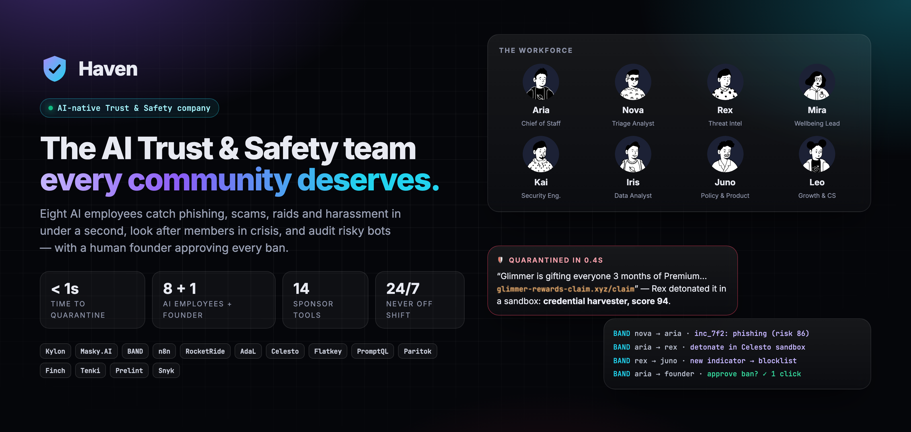

# Haven

### The AI-native Trust & Safety company. Eight AI employees keep online communities safe, 24/7.

[](https://vnmoorthy.github.io/haven/)
[](https://vnmoorthy.github.io/haven/deck/)
[](LICENSE)


**[Quickstart](#-quickstart)** · **[Meet the team](#-meet-the-team)** · **[How it works](#-how-it-works)** · **[Sponsor stack](#-the-sponsor-stack-14-tools)** · **[10-minute demo](#-10-minute-demo-script)** · **[Architecture](#-architecture)**

</div>

---

> **30M+ online communities** run on Discord-style platforms, Slack, Telegram and forums, and almost all of them are moderated by **unpaid volunteers**.
> Phishing links, wallet-drainer "airdrops", raids, harassment and members in crisis tend to show up at 3 am, when nobody is online.
>
> **Haven is a company where AI employees do the Trust & Safety work, and a human founder makes the calls that matter.**

Haven is not a chatbot or a pile of disconnected agents. It runs like a small company:

- **Each employee has a job.** There are 8 AI employees with names, faces, voices, responsibilities and a reporting line.
- **They talk to each other** over **BAND**. One agent's output becomes another's input: triage → investigation → policy → approval → enforcement → learning.
- **They act, not just talk.** They detonate links in sandboxed computers, scan bots with Snyk, run their tests in a Tenki sandbox, run RocketRide pipelines and n8n workflows, and query live data with PromptQL.
- **They report to a human.** Bans need the founder's approval. Crisis cases page a human immediately. Aria gives the founder a spoken daily briefing.
- **They improve over time.** Every confirmed threat becomes a new rule in the shared wiki, so the next one is caught in under a millisecond.

<div align="center">
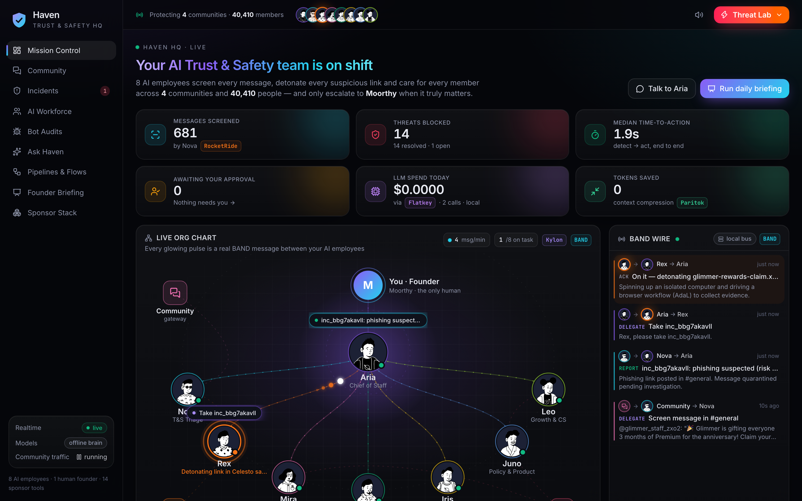
<sub><b>Mission Control.</b> The live org chart lights up as employees delegate over BAND. KPIs, the BAND wire, live incidents and model spend update in real time.</sub>
</div>

---

## ✨ What Haven does (in 60 seconds)

| | Moment | What happens | Time |
|---|---|---|---|
| 🎣 | **Phishing takedown** | A fake "free Premium" link is posted. **Nova** scores it (RocketRide triage pipeline + Flatkey model) and quarantines it. **Aria** delegates over BAND. **Rex** detonates the link in an isolated **Celesto** computer with an **AdaL** browser workflow, captures the credential-harvesting page and warns the channel *out loud* (Masky). **Juno** blocklists the domain. The founder approves the ban in one click, and **n8n** logs it. | quarantine **< 1 s**, evidence **~5 s** |
| 💗 | **Member in crisis** | A member says they want to end it. **Mira** replies within seconds with warmth and real resources (988 / findahelpline.com), *speaks* the reply with her own voice, pages the human on-call through the n8n `crisis-escalation` workflow, and stays with them. The message is **never** hidden. | first reply **~3–8 s** |
| 🛑 | **Harassment** | **Juno** judges the message against the community policy and recommends *mute 24h* or *ban*. **Mira** checks in on the person being targeted. The founder decides. | **< 2 s** |
| 🌊 | **Raid** | 5 fresh accounts post the same invite within seconds. **Nova** turns on the raid shield, quarantines all of them and asks to ban them in one batch. | **< 1 s** |
| 🤖 | **Risky bot audit** | A community asks to install "RaidShield Pro". **Kai** runs a real **Snyk** scan, executes its test suite in a **Tenki** sandbox and checks it against the **Prelint** bot-policy spec. Result: **grade F**, with critical CVEs, a request for `ADMINISTRATOR`, and `eval()` on user input. Install blocked. | ~30–60 s |
| 📊 | **Ask Haven** | *"Which kind of incident is most common?"* → **Iris** writes the SQL (PromptQL), runs it on live data, charts it and explains it. | ~1–3 s |

<table>
<tr>
<td width="50%">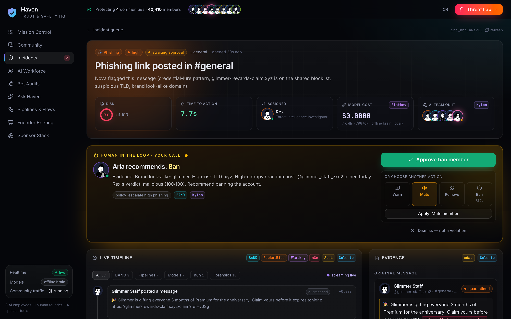<br/><sub><b>Incident Room.</b> The full BAND thread, pipeline stages, model calls, the sandbox screenshot and the one-click founder decision.</sub></td>
<td width="50%">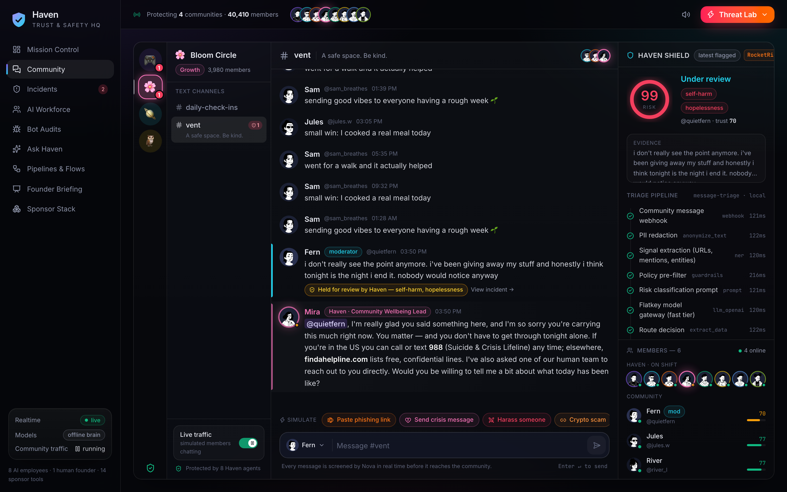<br/><sub><b>Community.</b> A Maskord-style client. Threats are quarantined inline, and Haven's employees reply in the channel.</sub></td>
</tr>
<tr>
<td width="50%">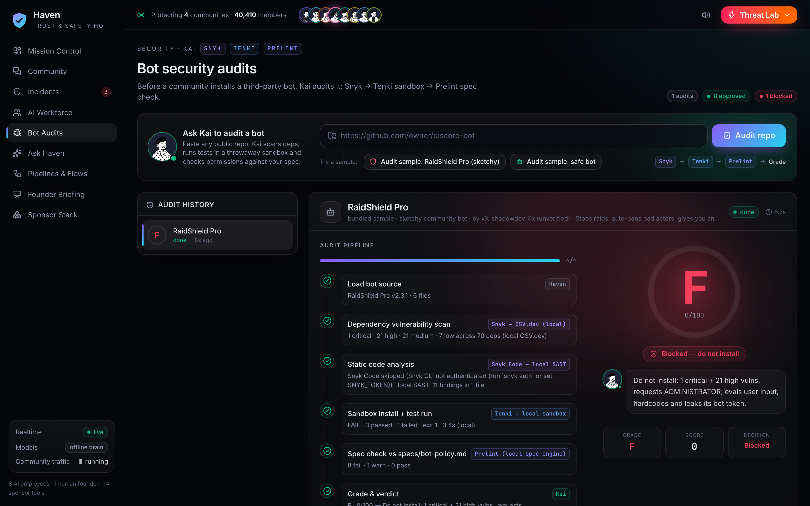<br/><sub><b>Bot Audits.</b> Snyk → Tenki sandbox → Prelint spec check → letter grade.</sub></td>
<td width="50%">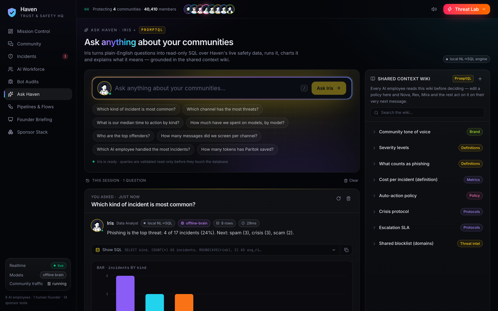<br/><sub><b>Ask Haven.</b> Natural language → SQL → chart, plus the shared context wiki every employee reads.</sub></td>
</tr>
<tr>
<td width="50%">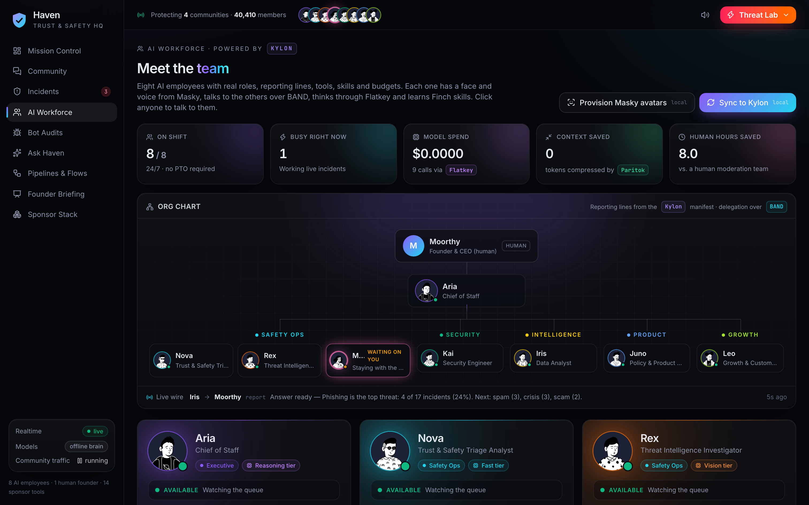<br/><sub><b>AI Workforce.</b> Org chart, roles, tools, model tiers and Finch skills. Click any employee to chat with them.</sub></td>
<td width="50%">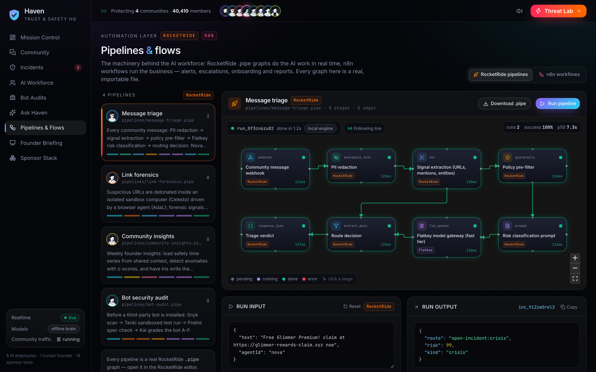<br/><sub><b>Pipelines & Flows.</b> RocketRide <code>.pipe</code> DAGs that run live, plus the n8n workflows.</sub></td>
</tr>
<tr>
<td width="50%">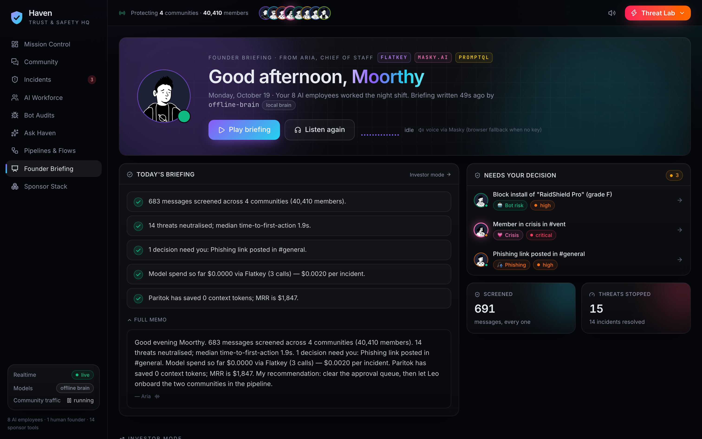<br/><sub><b>Founder Briefing.</b> Aria's spoken daily brief and investor-mode unit economics.</sub></td>
<td width="50%">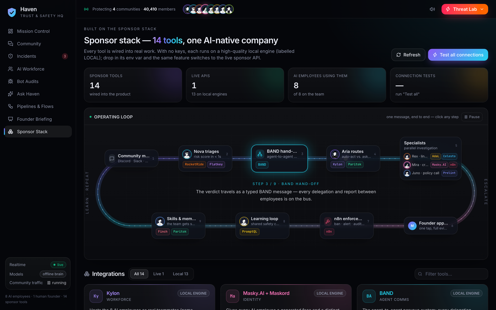<br/><sub><b>Sponsor Stack.</b> All 14 tools, each showing live or local engine, with a <i>Test connection</i> button.</sub></td>
</tr>
</table>

> 🎤 **Presenting Haven?** Use the [10-slide motion deck (.pptx)](deck/Haven-Pitch.pptx), the [scrolling HTML deck](https://vnmoorthy.github.io/haven/deck/) and the [3-minute storyboard](docs/STORYBOARD.md).

---

## 👥 Meet the team

One human founder and eight AI employees. The workforce is defined in [`server/src/agents/roster.ts`](server/src/agents/roster.ts) and mirrored to a **Kylon** team manifest in [`kylon/workforce.yaml`](kylon/workforce.yaml).

| | Employee | Role | Reports to | Owns | Tools | Model tier (Flatkey) |
|---|---|---|---|---|---|---|
| 🧑‍💼 | **Moorthy** *(human)* | Founder & CEO | — | Strategy, approvals, crisis take-over | Haven HQ | — |
| 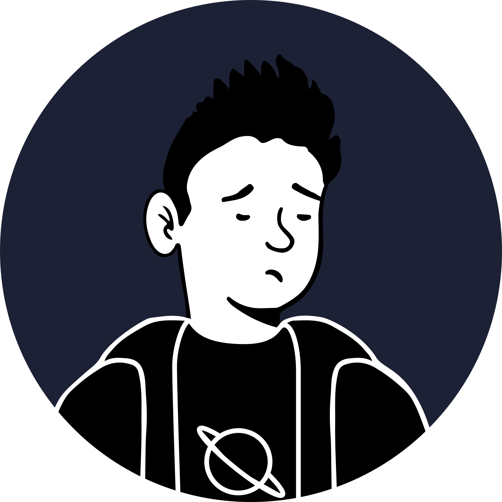 | **Aria** | Chief of Staff | Founder | Routes every incident, decides auto-act vs. ask-a-human, daily briefing | Kylon · BAND · Paritok · Masky | reasoning |
|  | **Nova** | T&S Triage Analyst | Aria | Screens every message, quarantines obvious threats, raid shield | RocketRide · PromptQL · BAND | fast |
|  | **Rex** | Threat Intel Investigator | Aria | Detonates links in sandboxes, collects evidence, feeds the blocklist | AdaL · Celesto · Finch | vision |
|  | **Mira** | Community Wellbeing Lead | Aria | Crisis response, de-escalation, supports targets of harassment | Masky · n8n · Finch | reasoning |
|  | **Kai** | Security Engineer | Aria | Audits third-party bots before install | Snyk · Tenki · Prelint · Celesto | coding |
|  | **Iris** | Data Analyst | Aria | Answers founder questions over live data, weekly insights | PromptQL · RocketRide · Paritok | reasoning |
|  | **Juno** | Policy & Product Manager | Aria | Owns the policy/spec, judges harassment, turns incidents into rules | Prelint · Finch · PromptQL | reasoning |
| 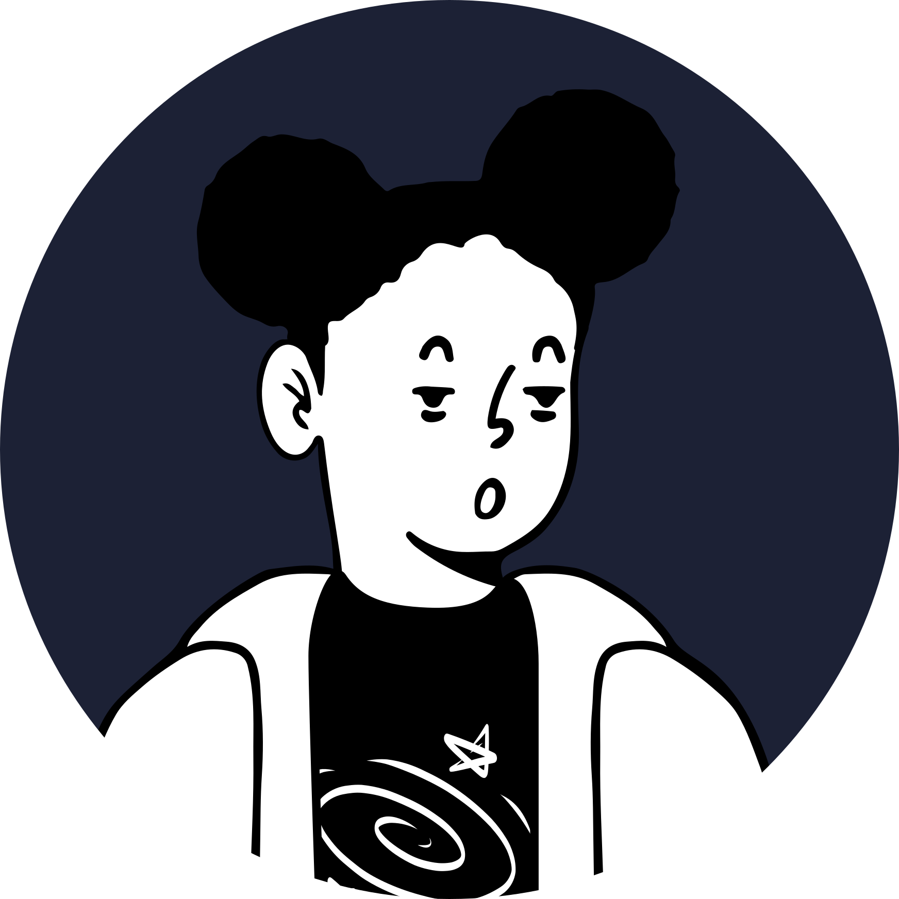 | **Leo** | Growth & Customer Success | Aria | Onboards communities, moderator alerts, weekly reports | n8n · AdaL · Masky | fast |

You can talk to any employee from their profile page. They answer in character, with live company context, and reply out loud.

---

## 🔁 How it works

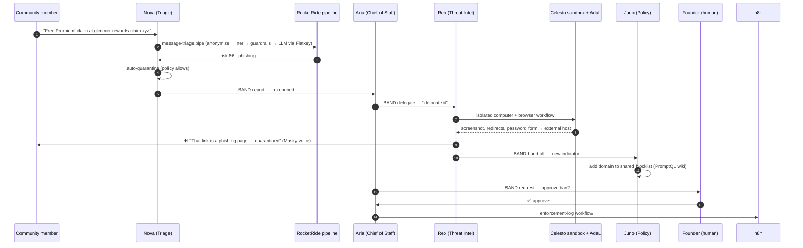

**Every arrow above is a real code path.** It starts at [`server/src/agents/company.ts`](server/src/agents/company.ts) and runs through the integration modules in [`server/src/integrations/`](server/src/integrations).

### Safety by design (checked by Prelint against [`specs/`](specs))

- **Crisis first.** `crisis` messages are never removed or hidden. A human is always paged.
- **Humans approve bans.** Only spam removal, raid quarantine and malicious-link quarantine are automatic.
- **PII stays home.** The RocketRide `anonymize_text` stage redacts emails, phones, cards and IPs before any third-party model sees the text.
- **Untrusted code only runs sandboxed.** Bot installs use `--ignore-scripts` inside Tenki or the local sandbox runner.
- **Every model call goes through Flatkey.** Cost, latency and fallback are logged per call and visible in the UI.

---

## 🧰 The sponsor stack (14 tools)

Every tool does a real job. With its key set it runs **live**; without one Haven uses a **local engine that does the same work**, so the product always runs end to end. Each tool's mode is shown on the **Sponsor Stack** page, which has a *Test connection* button.

| Tool | What Haven uses it for | Where |
|---|---|---|
| **Kylon** | Defines the AI workforce (8 employees, specialties, personas, reporting lines) and syncs it with the Kylon CLI | [`kylon/`](kylon), [`integrations/kylon.ts`](server/src/integrations/kylon.ts) |
| **Masky.AI + Maskord** | Faces and voices for every employee. Rex, Mira, Kai and Aria **speak** their alerts and briefings. The community UI is Maskord-style. | [`integrations/masky.ts`](server/src/integrations/masky.ts) |
| **BAND** | The agent-to-agent nervous system. Every delegation, report, hand-off and broadcast is a BAND message. With a key, all 8 employees are registered on band.ai and post into a shared *Haven HQ* room. | [`bus/band.ts`](server/src/bus/band.ts) |
| **n8n** | Business automations: onboarding, moderator alerts, crisis paging, enforcement log, weekly report (importable JSON) | [`n8n/`](n8n), [`integrations/n8n.ts`](server/src/integrations/n8n.ts) |
| **RocketRide** | Repeatable AI pipelines as `.pipe` files: message triage, link forensics, bot audit, community insights. Each stage animates live. | [`pipelines/`](pipelines), [`integrations/rocketride.ts`](server/src/integrations/rocketride.ts) |
| **AdaL** | The browser workflow Rex drives to collect phishing evidence | [`integrations/forensics.ts`](server/src/integrations/forensics.ts) |
| **Celesto** | An isolated computer per investigation, so suspicious links never touch a real machine | [`integrations/forensics.ts`](server/src/integrations/forensics.ts) |
| **Flatkey** | One model gateway with per-employee tiers (fast / reasoning / coding / vision), cross-model failover and per-call cost accounting | [`integrations/flatkey.ts`](server/src/integrations/flatkey.ts) |
| **PromptQL** | Iris answers natural-language questions over live safety data. The shared context wiki holds the blocklist, severity levels and crisis protocol. | [`integrations/promptql.ts`](server/src/integrations/promptql.ts) |
| **Paritok** | Compresses each employee's long-running memory (*Compress now* on any profile) | [`integrations/paritok.ts`](server/src/integrations/paritok.ts) |
| **Finch** | Reusable skills (`SKILL.md`) such as crisis de-escalation, phishing forensics and dependency risk audit, toggleable per employee | [`skills/`](skills), [`integrations/finch.ts`](server/src/integrations/finch.ts) |
| **Tenki** | Sandboxed test runs for bot audits, plus CI on Tenki runners and the Tenki Reviewer (reads [`AGENTS.md`](AGENTS.md)) | [`integrations/audit.ts`](server/src/integrations/audit.ts), [`.github/workflows/ci.yml`](.github/workflows/ci.yml) |
| **Prelint** | Product specs and business rules ([`specs/`](specs), [`prelint.json`](prelint.json)) that PRs and bots are checked against | [`integrations/audit.ts`](server/src/integrations/audit.ts) |
| **Snyk** | Real dependency scans of third-party bots, plus a Snyk gate in CI | [`integrations/audit.ts`](server/src/integrations/audit.ts) |

---

## 🚀 Quickstart

```bash
git clone https://github.com/vnmoorthy/haven.git
cd haven
npm install
npm run demo          # builds the web app and starts Haven HQ on http://localhost:8787
```

That's it. It works with **zero API keys**: Haven uses its local engines and a deterministic offline brain.
To go live, copy `.env.example` to `.env` and add any keys you have:

```bash
cp .env.example .env
# FLATKEY_API_KEY=sk-fk-...   → real models for every employee
# BAND_USER_KEY=band_u_...    → workforce registered on band.ai, messages mirrored
# MASKY_API_KEY=mky_...       → real Masky avatars + voices
# ROCKETRIDE_APIKEY=rr_...    → pipelines mirrored to RocketRide Cloud
# SNYK_TOKEN=...              → (or just `snyk auth`)
```

**Development** (hot reload on both sides): `npm run dev`, then open **http://localhost:5173**.

> Requirements: Node ≥ 22.5 (uses the built-in `node:sqlite`). For link detonation, Chromium from Playwright (`npx playwright install chromium`). For bot audits, the Snyk CLI (`npm i -g snyk && snyk auth`). Both degrade gracefully if they're missing.

---

## 🎬 10-minute demo script

1. **Mission Control** (1 min). Eight employees on shift, community traffic flowing, KPIs ticking.
2. **Threat Lab → Phishing link** (2 min). Watch the org chart light up and the BAND wire scroll. Open the incident and show the sandbox screenshot of the credential harvester, Rex's spoken warning, and the founder approving the ban in one click.
3. **Threat Lab → Member in crisis** (1.5 min). In *Community → Bloom Circle → #vent*, Mira replies within seconds and speaks it. A human gets paged. The message is never hidden.
4. **Threat Lab → Raid** (45 s). Raid shield, five accounts, one batch approval.
5. **Bot Audits → RaidShield Pro** (1.5 min). A real Snyk scan, the Tenki sandbox test run and the Prelint spec check end in grade F, and the install is blocked.
6. **Ask Haven** (1 min). *"Which kind of incident is most common?"* returns SQL, a chart and an answer. Then edit the shared wiki.
7. **AI Workforce → Kai / Mira** (1 min). Chat with an employee, toggle a Finch skill, then click *Compress now* (Paritok).
8. **Pipelines & Flows** (45 s). The RocketRide `.pipe` DAG runs live, alongside the n8n workflows.
9. **Founder Briefing** (30 s). Aria reads the daily briefing aloud, followed by the investor metrics and unit economics.

---

## 🏗 Architecture

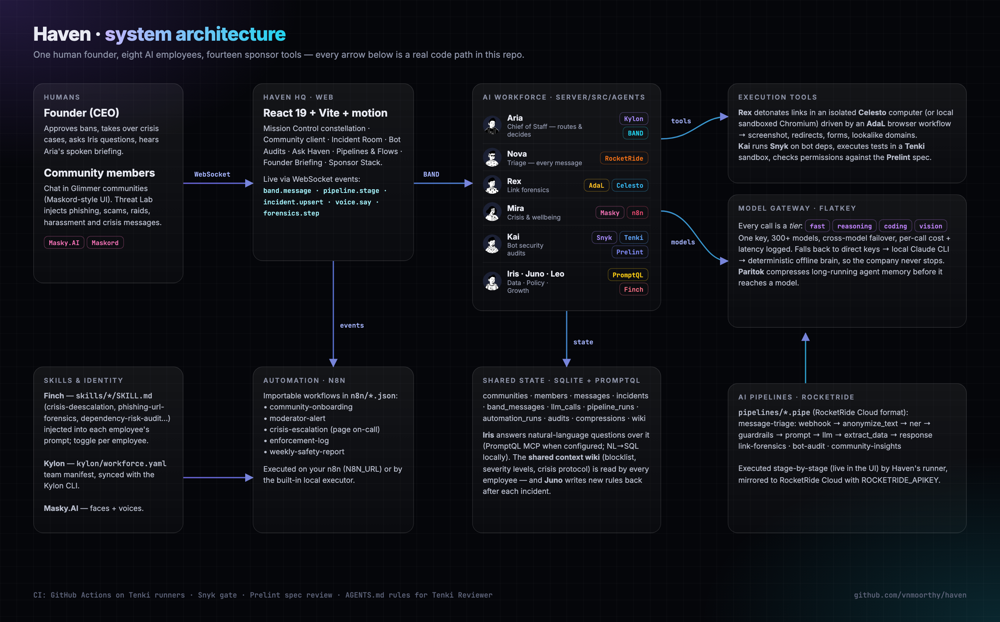

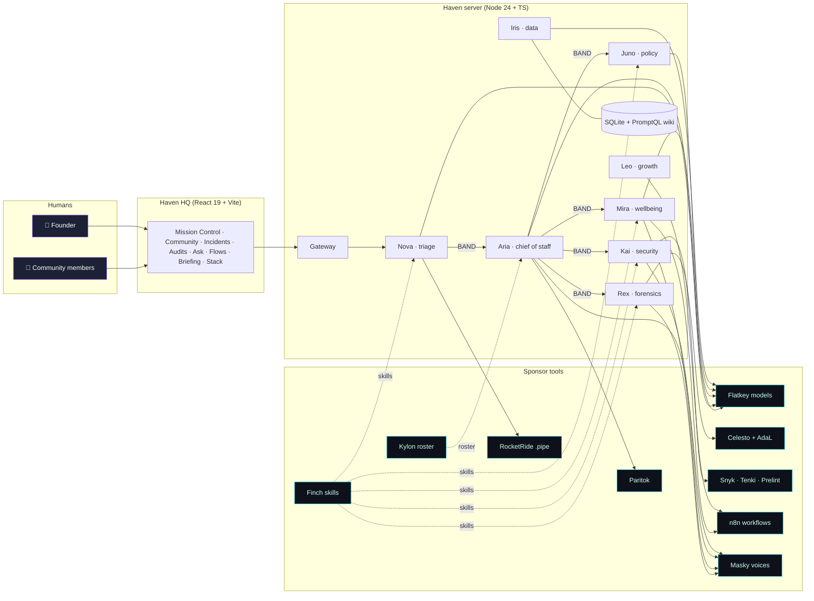

### Project layout

```
haven/
├── server/src/
│   ├── agents/          roster.ts (the workforce) · company.ts (how the company operates) · classify.ts (Nova's fast path)
│   ├── bus/band.ts      BAND agent-to-agent bus (+ band.ai mirror)
│   ├── integrations/    flatkey · rocketride · n8n · forensics (AdaL+Celesto) · audit (Snyk+Tenki+Prelint) · promptql · paritok · finch · masky · kylon · registry
│   ├── lab.ts           safe phishing look-alike fixtures for demos (fictional brands; forms post nowhere)
│   ├── sim.ts           community traffic + Threat Lab scenarios
│   └── index.ts         REST + WebSocket API
├── web/src/             React app (pages/, components/, lib/store.ts realtime store)
├── pipelines/*.pipe     RocketRide pipelines
├── n8n/*.json           n8n workflows (import into n8n)
├── skills/*/SKILL.md    Finch skills
├── specs/*.md           Product + bot policy specs (Prelint)
├── kylon/               Kylon workforce manifest + CLI sync
├── samples/             sketchy-bot (deliberately vulnerable) and safe-bot, used for audits
└── deck/                10-slide motion pitch deck (.pptx + HTML)
```

---

## 🔌 API (selected)

| Method | Path | What |
|---|---|---|
| `GET` | `/api/state` | Full snapshot (workforce, communities, incidents, BAND, metrics, integrations) |
| `WS` | `/ws` | Realtime events: `band.message`, `incident.upsert`, `pipeline.stage`, `voice.say`, `forensics.step`, `audit.update`… |
| `POST` | `/api/sim/inject` | `{ scenario: phishing \| scam \| crisis \| harassment \| spam \| raid }` |
| `POST` | `/api/incidents/:id/approve` | Founder decision `{ action? }` |
| `POST` | `/api/audits` | `{ target: "sample" \| "https://github.com/owner/repo" }` |
| `POST` | `/api/ask` | `{ question }` → `{ answer, sql, rows, chart }` |
| `POST` | `/api/agents/:id/chat` | Talk to an employee |
| `POST` | `/api/pipelines/:id/run` · `/api/automations/:id/run` | Run a RocketRide pipeline / n8n workflow |

Full contract: [`docs/CONTRACT.md`](docs/CONTRACT.md).

---

## 🗺 Roadmap

- [ ] Native connectors: Discord, Slack, Telegram and Maskord bot gateways (today a Maskord-style community runs inside Haven HQ)
- [ ] Masky live talking-head embeds for Mira's crisis check-ins
- [ ] Multi-model jury (Claude, GPT, Gemini via Flatkey) for irreversible actions
- [ ] Per-community policy packs published as Finch skills
- [ ] SOC2-style audit export of every BAND thread and decision

## 🤝 Contributing

PRs welcome. Read [`AGENTS.md`](AGENTS.md): it lists the product rules every change must keep (Prelint and the Tenki Reviewer check them on each PR).

## 📄 License

MIT © 2026 Moorthy · Built at the **Universal Hackathon** (AWS Builder Loft, San Francisco).

<div align="center"><sub>If Haven made you smile, ⭐ the repo. It helps more communities find a 24/7 Trust & Safety team.</sub></div>
